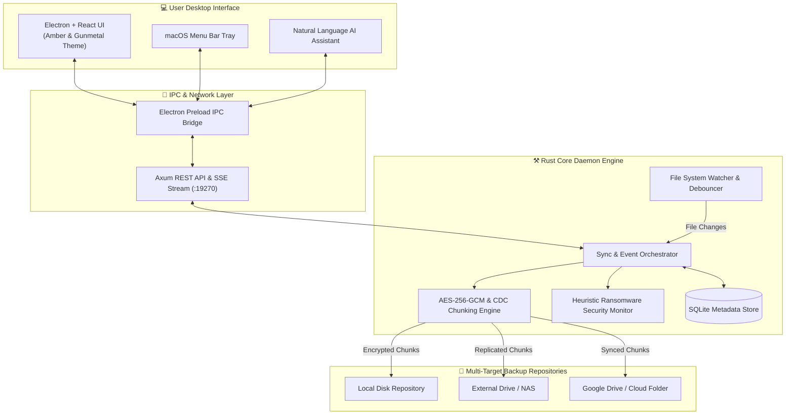
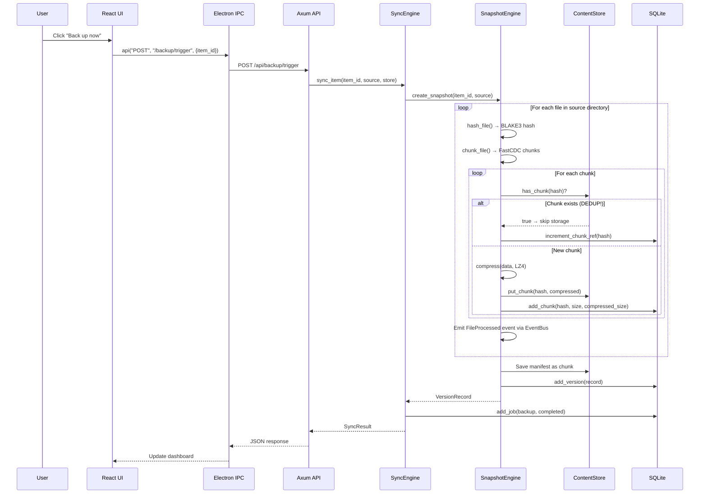
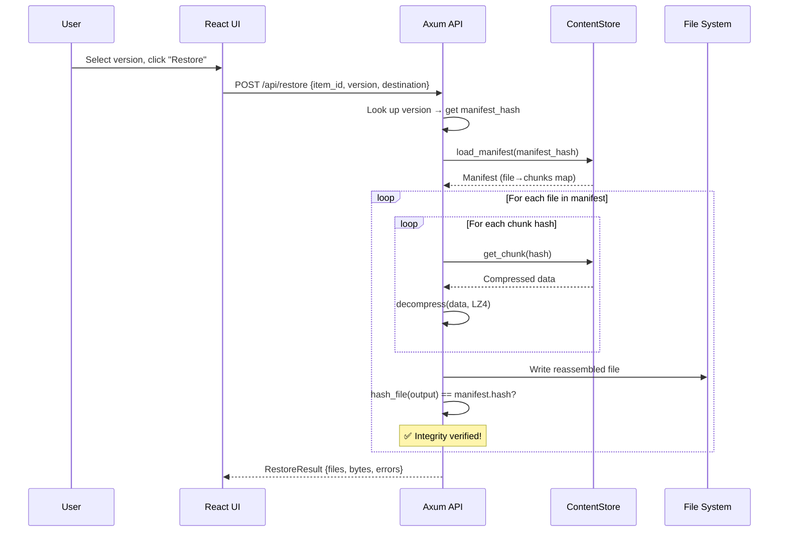

# ⚒️ FERRUM — Complete Project Review Guide

> **"Iron rusts. Ferrum doesn't."** 🔥
>
> **Student**: Sagar M | **Date**: October 13, 2026
> **Repository**: [Sagarverse/ferrum](https://github.com/Sagarverse/ferrum) | **License**: MIT

---

## Table of Contents

1. [Executive Summary](#1-executive-summary)
2. [Problem Statement & Motivation](#2-problem-statement--motivation)
3. [Technology Stack](#3-technology-stack)
4. [System Architecture](#4-system-architecture)
5. [Project Structure & Codebase Stats](#5-project-structure--codebase-stats)
6. [Core Engine (Rust) — Module-by-Module Deep Dive](#6-core-engine-rust--module-by-module-deep-dive)
   - 6.1 [Entry Point: main.rs](#61-entry-point-mainrs)
   - 6.2 [Library Root: lib.rs & AppState](#62-library-root-librs--appstate)
   - 6.3 [Database Layer (db/)](#63-database-layer-db)
   - 6.4 [Cryptographic Engine (crypto/)](#64-cryptographic-engine-crypto)
   - 6.5 [Content-Addressable Storage (repository/)](#65-content-addressable-storage-repository)
   - 6.6 [Versioning & Snapshots (versioning/)](#66-versioning--snapshots-versioning)
   - 6.7 [File System Watcher (watcher/)](#67-file-system-watcher-watcher)
   - 6.8 [Sync Engine (sync/)](#68-sync-engine-sync)
   - 6.9 [Security & Ransomware Detection (security/)](#69-security--ransomware-detection-security)
   - 6.10 [Recovery Engine (recovery/)](#610-recovery-engine-recovery)
   - 6.11 [REST API Server (api/)](#611-rest-api-server-api)
   - 6.12 [Event Bus & SSE Streaming (events.rs)](#612-event-bus--sse-streaming-eventsrs)
   - 6.13 [Configuration & Settings (config/)](#613-configuration--settings-config)
   - 6.14 [Job Scheduler (scheduler/)](#614-job-scheduler-scheduler)
   - 6.15 [AI Engine (ai/)](#615-ai-engine-ai)
   - 6.16 [Cloud Provider (cloud/)](#616-cloud-provider-cloud)
   - 6.17 [Health Monitoring (health/)](#617-health-monitoring-health)
7. [Frontend (Electron + React) — Deep Dive](#7-frontend-electron--react--deep-dive)
   - 7.1 [Electron Main Process](#71-electron-main-process)
   - 7.2 [Preload & IPC Bridge](#72-preload--ipc-bridge)
   - 7.3 [React Application & Pages](#73-react-application--pages)
8. [Data Flow Diagrams](#8-data-flow-diagrams)
9. [Database Schema — Complete ER Diagram](#9-database-schema--complete-er-diagram)
10. [API Endpoint Reference](#10-api-endpoint-reference)
11. [Key Design Patterns & Decisions](#11-key-design-patterns--decisions)
12. [Testing Strategy](#12-testing-strategy)
13. [Interview Q&A — Likely Questions & Answers](#13-interview-qa--likely-questions--answers)

---

## 1. Executive Summary

**Ferrum** (Latin for *iron*) is a **high-performance, real-time Continuous Data Protection (CDP) engine** built with a **Rust backend** and an **Electron + React** desktop interface. It provides:

- **Sub-millisecond file change detection** using OS-native filesystem watchers
- **Content-Defined Chunking (FastCDC)** for efficient, incremental backups
- **AES-256-GCM encryption** at rest for all backup data
- **BLAKE3 hashing** for lightning-fast integrity verification
- **Automatic deduplication** to minimize storage footprint
- **Multi-target storage replication** (local, external, cloud)
- **Heuristic ransomware detection** with quarantine capabilities
- **Point-in-time recovery** with version timeline browsing
- **AI-assisted natural language configuration**
- **macOS menu bar integration** for silent background operation

### Codebase Stats

| Metric | Count |
|--------|-------|
| **Rust backend (core/)** | ~6,748 lines across 15 modules |
| **React UI (ui/src/)** | ~3,726 lines (9 pages + components) |
| **Electron shell (ui/electron/)** | ~422 lines (main + preload) |
| **Total lines of code** | **~10,896 lines** |
| **Rust dependencies** | 27 production crates |
| **NPM dependencies** | 7 production + 7 dev packages |
| **SQLite tables** | 12 tables with indexes |
| **REST API endpoints** | 22 endpoints |
| **UI pages** | 9 full pages |

---

## 2. Problem Statement & Motivation

### The Problem
Traditional backup tools suffer from:
1. **Periodic snapshots only** — data changes between backups are lost
2. **No encryption by default** — backup data sits unprotected on disk
3. **No deduplication** — storing full copies wastes enormous disk space
4. **Zero ransomware awareness** — backups can be encrypted/corrupted by malware
5. **Complex UIs** — most backup tools have outdated, unintuitive interfaces

### Our Solution
Ferrum addresses all of these with a **zero-trust, real-time** approach:
- **Continuous** — every file change is captured in real-time via filesystem watchers
- **Chunked & Deduplicated** — only the changed portions of files are stored, saving 60-90% space
- **Encrypted** — AES-256-GCM ensures backup data is unreadable without the key
- **Smart Security** — heuristic analysis detects ransomware patterns before corruption spreads
- **Premium UI** — modern glassmorphism desktop app with dark theme and AI assistant

---

## 3. Technology Stack

| Component | Technology | Why This Choice |
|-----------|-----------|-----------------|
| **Core Engine** | **Rust 2021 Edition** | Memory safety without GC, zero-cost abstractions, fearless concurrency |
| **Async Runtime** | **Tokio** | Best-in-class async runtime for Rust; powers all concurrent operations |
| **HTTP Server** | **Axum** | Modern, ergonomic Rust web framework built on Tower middleware |
| **Database** | **SQLite (WAL mode)** | Zero-config, embedded, supports concurrent readers, battle-tested |
| **Hashing** | **BLAKE3** | Fastest cryptographic hash available (7× faster than SHA-256), SIMD-accelerated |
| **Chunking** | **FastCDC** | Content-defined chunking that adapts to data boundaries for optimal deduplication |
| **Compression** | **LZ4 / Zstd** | LZ4 for speed (4 GB/s), Zstd for better ratio when archiving |
| **Encryption** | **AES-256-GCM** | Hardware-accelerated (AES-NI), authenticated encryption prevents tampering |
| **Key Derivation** | **Argon2id** | Memory-hard KDF, resistant to GPU/ASIC brute-force attacks |
| **Desktop Shell** | **Electron v36** | Cross-platform desktop app with native OS integration (tray, dialogs) |
| **UI Framework** | **React 18 + TypeScript** | Component-based UI with reactive state management |
| **Build System** | **Vite** | Lightning-fast HMR for frontend development |
| **Charts** | **Recharts** | React-native SVG charting library |
| **Animations** | **Framer Motion** | Production-grade motion library for React |
| **State** | **Zustand** | Lightweight, TypeScript-first state management |
| **Icons** | **Lucide React** | Beautiful, consistent SVG icon set |

---

## 4. System Architecture



### Architecture Key Points (Explain This!)
1. **Two-Process Model**: The Rust daemon runs as a separate OS process; the Electron UI communicates over localhost HTTP (port 19270)
2. **Event-Driven**: Filesystem changes trigger an async pipeline: Watch → Debounce → Chunk → Dedup → Compress → Store
3. **Zero-Trust**: Every piece of data is hashed (BLAKE3) and optionally encrypted (AES-256-GCM) before writing to disk
4. **IPC Bridge**: The renderer process never directly touches the network — all API calls route through Electron's `ipcMain` for security (context isolation)
5. **SSE Streaming**: Real-time events flow from the Rust daemon → Electron main process → React UI via Server-Sent Events

---

## 5. Project Structure & Codebase Stats

```
Metallic/
├── core/                           # Rust Backend Core Engine
│   ├── Cargo.toml                  # 27 dependencies, release profile with LTO
│   └── src/
│       ├── main.rs                 # Daemon entry point (192 lines)
│       ├── lib.rs                  # Library root + AppState (65 lines)
│       ├── events.rs               # Event bus for SSE (92 lines)
│       ├── api/                    # Axum HTTP server
│       │   ├── server.rs           # Router with 22 routes (84 lines)
│       │   ├── handlers.rs         # Request handlers (686 lines)
│       │   ├── events.rs           # SSE stream endpoint
│       │   └── models.rs           # API request/response types
│       ├── db/                     # SQLite database layer
│       │   ├── mod.rs              # Database struct + 30 methods (705 lines)
│       │   └── schema.rs           # 12 tables, 2 migrations (273 lines)
│       ├── crypto/                 # Encryption & integrity
│       │   ├── keys.rs             # AES-256-GCM + Argon2id (281 lines)
│       │   └── integrity.rs        # BLAKE3 hashing (136 lines)
│       ├── repository/             # Content-addressable storage
│       │   ├── chunk.rs            # FastCDC chunker (326 lines)
│       │   ├── store.rs            # Content store (310 lines)
│       │   ├── manifest.rs         # Version manifests (256 lines)
│       │   ├── dedup.rs            # Deduplication engine
│       │   ├── compress.rs         # LZ4/Zstd compression
│       │   └── gc.rs               # Garbage collection
│       ├── versioning/             # Version management
│       │   ├── snapshot.rs         # Snapshot creation (300 lines)
│       │   ├── retention.rs        # GFS retention policies (136 lines)
│       │   └── timeline.rs         # Version timeline
│       ├── watcher/                # Filesystem monitoring
│       │   ├── mod.rs              # notify crate integration (65 lines)
│       │   ├── events.rs           # Event types
│       │   └── debouncer.rs        # Event coalescing (106 lines)
│       ├── sync/                   # Sync orchestrator
│       │   ├── engine.rs           # Backup pipeline (133 lines)
│       │   └── replica.rs          # Replica management
│       ├── security/               # Threat detection
│       │   ├── detector.rs         # Behavioral analysis (183 lines)
│       │   ├── scoring.rs          # Threat scoring 0-100 (64 lines)
│       │   ├── rules.rs            # Entropy + pattern detection (87 lines)
│       │   └── quarantine.rs       # Quarantine manager (65 lines)
│       ├── recovery/               # Data recovery
│       │   ├── restore.rs          # File reassembly + verify (117 lines)
│       │   ├── repair.rs           # Replica repair
│       │   └── delete_protect.rs   # Delete protection
│       ├── config/                 # Configuration
│       │   ├── settings.rs         # App settings (156 lines)
│       │   └── policy.rs           # Backup policies
│       ├── scheduler/              # Job scheduling
│       ├── ai/                     # AI engine (LLM integration)
│       ├── cloud/                  # Cloud provider abstraction
│       ├── health/                 # Health monitoring
│       └── platform/               # OS abstractions
│
└── ui/                             # Frontend Desktop App
    ├── package.json                # Electron 36 + React 18
    ├── electron/
    │   ├── main.js                 # Electron main process (384 lines)
    │   └── preload.js              # IPC bridge (40 lines)
    └── src/
        ├── App.tsx                 # Router + page switching
        ├── index.css               # Design system (30K of CSS)
        └── pages/
            ├── Home.tsx            # Dashboard + status
            ├── HowItWorks.tsx      # Visual backup pipeline
            ├── ProtectedData.tsx   # File/folder management
            ├── Versions.tsx        # Version timeline
            ├── Recovery.tsx        # Point-in-time restore
            ├── Storage.tsx         # Storage analytics
            ├── Security.tsx        # Threat monitoring
            ├── Settings.tsx        # App configuration
            └── Assistant.tsx       # AI chat interface
```

---

## 6. Core Engine (Rust) — Module-by-Module Deep Dive

### 6.1 Entry Point: main.rs

[main.rs](file:///Users/sagarm/Mine/Metallic/core/src/main.rs) is the **daemon entry point** — the binary that runs as a background service.

**What it does (step by step):**

```
1. Initialize structured logging (tracing_subscriber with env filter)
2. Determine data directory (~/Library/Application Support/Ferrum/ on macOS)
3. Open SQLite database → auto-runs migrations
4. Load Settings from DB (or create defaults)
5. Create broadcast shutdown channel (for graceful shutdown)
6. Create shared EventBus (capacity 1024 events)
7. Initialize all subsystems:
   - SyncEngine (orchestrates backups)
   - SecurityMonitor (ransomware detection)
   - JobScheduler (background task management)
   - HealthMonitor (system health scoring)
8. Build AppState (shared across all threads via Arc)
9. Spawn background tasks (scheduler, security, health) with shutdown guards
10. Start Axum HTTP server on port 19270
11. Wait for Ctrl+C → broadcast shutdown → join all tasks → exit
```

**Key Code Pattern — Graceful Shutdown:**
```rust
let (shutdown_tx, _) = tokio::sync::broadcast::channel::<()>(1);

// Each background task uses tokio::select! to race work vs shutdown:
tokio::select! {
    _ = scheduler.run() => {},          // Normal work
    _ = shutdown_rx.recv() => {         // Shutdown signal
        info!("Scheduler shutting down");
    },
}
```

> [!IMPORTANT]
> **Why `tokio::select!`?** It races two futures concurrently. Whichever completes first "wins" — the other is dropped. This is how Tokio programs implement graceful shutdown.

---

### 6.2 Library Root: lib.rs & AppState

[lib.rs](file:///Users/sagarm/Mine/Metallic/core/src/lib.rs) exports all 15 modules and defines the **shared application state**.

```rust
pub struct AppState {
    pub db: Arc<Database>,                              // Thread-safe DB
    pub settings: Arc<RwLock<Settings>>,                // Read-heavy settings
    pub watcher_handle: Arc<RwLock<Option<WatcherHandle>>>,  // FS watcher
    pub sync_engine: Arc<SyncEngine>,                   // Backup pipeline
    pub security_monitor: Arc<SecurityMonitor>,         // Threat detection
    pub scheduler: Arc<JobScheduler>,                   // Background jobs
    pub health_monitor: Arc<HealthMonitor>,             // Health scoring
    pub event_bus: EventBus,                            // SSE event stream
    pub shutdown_tx: broadcast::Sender<()>,             // Shutdown signal
}
```

> **Why `Arc<T>`?** Rust has no garbage collector. `Arc` (Atomic Reference Counting) allows multiple threads to share ownership of data safely. Each `clone()` increments the count; when the last clone is dropped, the data is freed.

> **Why `RwLock<T>`?** Settings are read far more often than written. `RwLock` allows unlimited concurrent readers OR one exclusive writer — unlike `Mutex` which blocks all access during any lock.

---

### 6.3 Database Layer (db/)

**Files:** [mod.rs](file:///Users/sagarm/Mine/Metallic/core/src/db/mod.rs) (705 lines) + [schema.rs](file:///Users/sagarm/Mine/Metallic/core/src/db/schema.rs) (273 lines)

#### Schema (12 Tables)

```mermaid
erDiagram
    protected_items ||--o{ versions : "has many"
    protected_items ||--o{ file_metadata : "has many"
    protected_items }|--|| policies : "belongs to"
    versions ||--o{ manifest_entries : "has many"
    policies ||--o{ jobs : "triggers"

    protected_items {
        TEXT id PK
        TEXT path
        TEXT item_type "file or folder"
        TEXT policy_id FK
        TEXT target_replica_id FK
        TEXT status "active|paused|unlinked|deleted"
    }
    
    versions {
        TEXT id PK
        TEXT protected_item_id FK
        INTEGER version_number
        TEXT manifest_hash
        INTEGER total_size
        INTEGER total_chunks
        TEXT status "healthy|suspicious|quarantined"
    }
    
    chunks {
        TEXT hash PK
        INTEGER size
        INTEGER compressed_size
        INTEGER ref_count
    }
    
    replicas {
        TEXT id PK
        TEXT name
        TEXT path
        TEXT replica_type "mirror|encrypted"
        INTEGER enabled
        TEXT status "healthy|degraded|disconnected"
    }
    
    incidents {
        TEXT id PK
        TEXT severity "low|medium|high|critical"
        INTEGER threat_score
        TEXT process_name
        INTEGER affected_files
        TEXT status "active|resolved|false_positive"
    }
    
    jobs {
        TEXT id PK
        TEXT job_type "backup|restore|verify|repair|gc"
        TEXT status "running|completed|failed"
        INTEGER files_processed
        INTEGER bytes_processed
    }
```



#### Key Database Design Decisions

1. **WAL Mode**: `PRAGMA journal_mode=WAL` — allows concurrent reads while a write is in progress. Critical for a backup engine where status queries happen during backup.

2. **Thread Safety**: `Database` wraps `Connection` in `Mutex<Connection>`. Only one thread can execute SQL at a time, but reads don't block each other thanks to WAL.

3. **Transactional Deletes**: When removing a protected item, a transaction cascades deletes across `manifest_entries → versions → file_metadata → protected_items` atomically.

4. **Migration System**: Schema versioning via `schema_migrations` table. Each migration is idempotent. Currently at v2.

```rust
// Thread-safe database wrapper
pub struct Database {
    conn: Mutex<Connection>,  // Only one writer at a time
}

impl Database {
    pub fn open(data_dir: &Path) -> anyhow::Result<Self> {
        let conn = Connection::open(&db_path)?;
        conn.execute_batch("PRAGMA journal_mode=WAL;")?;   // Concurrent reads
        conn.execute_batch("PRAGMA synchronous=NORMAL;")?;  // Faster writes
        conn.execute_batch("PRAGMA foreign_keys=ON;")?;     // Enforce FKs
        conn.execute_batch("PRAGMA busy_timeout=5000;")?;   // Wait 5s on lock
        // ... run migrations
    }
}
```

---

### 6.4 Cryptographic Engine (crypto/)

**Files:** [keys.rs](file:///Users/sagarm/Mine/Metallic/core/src/crypto/keys.rs) (281 lines) + [integrity.rs](file:///Users/sagarm/Mine/Metallic/core/src/crypto/integrity.rs) (136 lines)

#### BLAKE3 Hashing (integrity.rs)

BLAKE3 is the **fastest cryptographic hash** available — 7× faster than SHA-256 on modern CPUs thanks to SIMD (Single Instruction, Multiple Data) acceleration.

```rust
/// Hash raw bytes → 64-char hex string (256 bits)
pub fn hash_bytes(data: &[u8]) -> String {
    let hash = blake3::hash(data);
    hash.to_hex().to_string()
}

/// Stream-hash a file (never loads entire file into RAM)
pub fn hash_file(path: &Path) -> Result<String, IntegrityError> {
    let mut reader = BufReader::with_capacity(64 * 1024, File::open(path)?);
    let mut hasher = blake3::Hasher::new();
    let mut buf = vec![0u8; 64 * 1024]; // 64 KB buffer
    loop {
        let n = reader.read(&mut buf)?;
        if n == 0 { break; }
        hasher.update(&buf[..n]);  // Feed chunks to hasher
    }
    Ok(hasher.finalize().to_hex().to_string())
}
```

> **Why stream-hashing?** A 10 GB video file would crash if loaded entirely into RAM. By reading 64 KB at a time, we can hash files of unlimited size with only 64 KB memory.

#### AES-256-GCM Encryption (keys.rs)

```
                    ┌──────────────┐
   Plaintext ──────►│  AES-256-GCM │──────► [Nonce (12B)] [Ciphertext + Tag (16B)]
                    │              │
   Key (32B) ──────►│  Encrypt     │
   Nonce (12B) ────►│              │
                    └──────────────┘
```

**Encryption Format:** `[12-byte random nonce] [ciphertext] [16-byte authentication tag]`

```rust
pub fn encrypt_aes256gcm(key: &EncryptionKey, plaintext: &[u8]) -> Result<Vec<u8>> {
    let cipher = Aes256Gcm::new_from_slice(key.as_bytes())?;
    let mut nonce_bytes = [0u8; 12];
    rand::thread_rng().fill_bytes(&mut nonce_bytes);  // Random nonce
    let ciphertext = cipher.encrypt(Nonce::from_slice(&nonce_bytes), plaintext)?;
    
    let mut output = Vec::with_capacity(12 + ciphertext.len());
    output.extend_from_slice(&nonce_bytes);     // Prepend nonce
    output.extend_from_slice(&ciphertext);      // Then ciphertext + tag
    Ok(output)
}
```

> [!IMPORTANT]
> **GCM = Galois/Counter Mode** — it provides both **confidentiality** (encryption) AND **authenticity** (tamper detection). The 16-byte authentication tag is appended automatically. If anyone modifies even one bit, decryption fails.

#### Key Derivation (Argon2id)

When deriving keys from passwords:
```rust
pub fn from_password(password: &str) -> Result<EncryptionKey> {
    let mut salt_bytes = vec![0u8; 16];
    rand::thread_rng().fill_bytes(&mut salt_bytes);  // Random 16-byte salt
    let argon2 = Argon2::default();  // Argon2id with default params
    let hash = argon2.hash_password(password.as_bytes(), &salt)?;
    // Take first 32 bytes as AES-256 key
    Ok(EncryptionKey { key_bytes: hash[..32].to_vec(), salt: Some(salt_bytes) })
}
```

> **Why Argon2id?** It's memory-hard, meaning attackers need both CPU time AND large amounts of RAM to brute-force. GPU farms that crack SHA-256 passwords in seconds would take years on Argon2id.

**Secure Memory Handling:**
```rust
impl Drop for EncryptionKey {
    fn drop(&mut self) {
        for b in &mut self.key_bytes { *b = 0; }  // Zero-out key on drop
    }
}
```

---

### 6.5 Content-Addressable Storage (repository/)

This is the **heart of the backup engine** — the module that actually stores data.

#### Content-Defined Chunking (chunk.rs)

**What is CDC?** Instead of splitting files at fixed boundaries (e.g., every 64 KB), CDC uses a rolling hash to find **content-dependent** split points. This means:
- Inserting a byte at the beginning of a file only affects the first chunk, not all chunks
- Common content across files produces identical chunks → automatic deduplication

```
Traditional Fixed-Size Chunking:     Content-Defined Chunking (FastCDC):
┌────────┬────────┬────────┐         ┌──────┬──────────┬────────┐
│ 64 KB  │ 64 KB  │ 64 KB  │         │ 50KB │  72 KB   │ 60 KB  │
└────────┴────────┴────────┘         └──────┴──────────┴────────┘
    ↓ Insert 1 byte at start             ↓ Insert 1 byte at start
┌────────┬────────┬────────┐         ┌──────┬──────────┬────────┐
│ ALL    │  ALL   │  ALL   │ ← ALL   │ 51KB │  72 KB   │ 60 KB  │ ← Only
│CHANGED │CHANGED │CHANGED │  CHANGE │CHANGED│ SAME!   │ SAME!  │   first
└────────┴────────┴────────┘         └──────┴──────────┴────────┘   changes
```

```rust
// Chunk configuration adapts to file size
pub struct ChunkConfig {
    pub min_size: u32,    // 4 KB minimum
    pub avg_size: u32,    // 64 KB average (1 MB for large files)
    pub max_size: u32,    // 256 KB max (4 MB for large files)
}

pub fn chunk_data(data: &[u8], config: &ChunkConfig) -> Vec<Chunk> {
    let chunker = fastcdc::v2020::FastCDC::new(
        data, config.min_size, config.avg_size, config.max_size
    );
    let mut chunks = Vec::new();
    for entry in chunker {
        let chunk_data = &data[entry.offset..entry.offset + entry.length];
        let hash = blake3::hash(chunk_data);  // Content address = hash
        chunks.push(Chunk { hash, offset, size, data: chunk_data.to_vec() });
    }
    chunks
}
```

> **Files > 100 MB** automatically use larger chunks (avg 1 MB) to reduce metadata overhead.

#### Content Store (store.rs)

Chunks are stored in a **hash-addressed directory hierarchy**:

```
repository/chunks/
├── ab/
│   └── cd/
│       └── abcdef1234567890...   ← Full 64-char BLAKE3 hash as filename
├── 3f/
│   └── a1/
│       └── 3fa12b...
```

**Atomic Write Pattern:**
```rust
pub fn put_chunk(&self, hash: &str, data: &[u8]) -> Result<bool> {
    let path = self.chunk_path(hash);
    if path.exists() { return Ok(false); }   // DEDUPLICATION: skip if exists
    
    // Write to .tmp first, then atomic rename
    let tmp_path = path.with_extension("tmp");
    let mut file = File::create(&tmp_path)?;
    file.write_all(data)?;
    file.sync_all()?;              // Flush to disk
    std::fs::rename(&tmp_path, &path)?;  // Atomic rename
    Ok(true)  // true = new chunk stored
}
```

> **Why atomic rename?** If the process crashes mid-write, we'd have a corrupt chunk file. By writing to `.tmp` first and then renaming (which is atomic on all major OSes), we guarantee the chunk file is either complete or doesn't exist.

**Self-Healing Cross-Repository Fallback:**
```rust
pub fn get_chunk(&self, hash: &str) -> Result<Vec<u8>> {
    // Try primary location first
    if path.exists() { return Ok(std::fs::read(&path)?); }
    
    // Self-healing: search sibling repositories
    if let Some(parent_dir) = self.root.parent() {
        for entry in std::fs::read_dir(parent_dir)? {
            let candidate = entry.path().join("chunks").join(prefix).join(hash);
            if candidate.exists() {
                let data = std::fs::read(&candidate)?;
                self.put_chunk(hash, &data)?;  // Copy to local repo
                return Ok(data);
            }
        }
    }
    Err(StoreError::ChunkNotFound(hash))
}
```

#### Manifest System (manifest.rs)

A **manifest** is the complete description of a version — mapping every file path to its ordered list of chunks:

```json
{
  "version_id": "550e8400-e29b-41d4-a716-446655440000",
  "protected_item_id": "item-uuid",
  "version_number": 3,
  "total_files": 150,
  "total_size": 52428800,
  "total_chunks": 820,
  "files": {
    "src/main.rs": {
      "size": 5963,
      "hash": "blake3-hash-of-entire-file",
      "modified_at": "2026-10-12T...",
      "chunks": ["chunk-hash-1", "chunk-hash-2"],
      "is_symlink": false
    },
    "README.md": { ... }
  }
}
```

Manifests themselves are stored as chunks in the content store (self-referential!). The version record in SQLite only stores the manifest's BLAKE3 hash — a pointer to the manifest "chunk."

**Manifest Diffing** enables comparing versions:
```rust
pub fn diff(&self, other: &Manifest) -> ManifestDiff {
    // Returns: { added: [...], modified: [...], deleted: [...], unchanged: [...] }
}
```

---

### 6.6 Versioning & Snapshots (versioning/)

**Files:** [snapshot.rs](file:///Users/sagarm/Mine/Metallic/core/src/versioning/snapshot.rs) (300 lines) + [retention.rs](file:///Users/sagarm/Mine/Metallic/core/src/versioning/retention.rs) (136 lines)

#### Snapshot Creation Pipeline

```
                    ┌─────────────────────────────────────────────────┐
                    │         SnapshotEngine.create_snapshot()        │
                    └─────────────────────────────────────────────────┘
                                         │
                    ┌────────────────────┼────────────────────┐
                    │                    │                    │
               ┌────▼────┐        ┌─────▼─────┐       ┌─────▼─────┐
               │ Walk Dir │        │ Process   │       │ Excluded  │
               │ (walkdir)│───────►│ Each File │◄──────│ Files     │
               └─────────┘        └─────┬─────┘       └───────────┘
                                        │
                              ┌─────────▼──────────┐
                              │  For each file:    │
                              │  1. hash_file()    │
                              │  2. chunk_file()   │
                              │  3. check dedup    │
                              │  4. compress()     │
                              │  5. store chunk    │
                              │  6. record in DB   │
                              └─────────┬──────────┘
                                        │
                              ┌─────────▼──────────┐
                              │ Build Manifest     │
                              │ → Save to store    │
                              │ → Record version   │
                              └────────────────────┘
```

**Exclusion Patterns** (hardcoded smart defaults):
```rust
fn should_exclude(path: &str) -> bool {
    // Exclude: .DS_Store, Thumbs.db, .git/, node_modules/, target/,
    //          __pycache__/, .idea/, .vscode/, .tmp, .swp, .swo, .pyc
}
```

#### Retention Policies (GFS — Grandfather-Father-Son)

```rust
pub struct RetentionPolicy {
    keep_all_hours: u32,        // Keep ALL versions for last N hours
    keep_daily_days: u32,       // Keep 1/day for N days
    keep_weekly_weeks: u32,     // Keep 1/week for N weeks
    keep_monthly_months: u32,   // Keep 1/month for N months
    max_versions: u32,          // Hard cap on total versions
}
```

The retention engine always keeps the **first** (initial backup) and **last** (most recent) versions.

---

### 6.7 File System Watcher (watcher/)

**Files:** [mod.rs](file:///Users/sagarm/Mine/Metallic/core/src/watcher/mod.rs) + [events.rs](file:///Users/sagarm/Mine/Metallic/core/src/watcher/events.rs) + [debouncer.rs](file:///Users/sagarm/Mine/Metallic/core/src/watcher/debouncer.rs)

Uses the `notify` crate for cross-platform filesystem monitoring:
- **macOS**: FSEvents (kernel-level, very efficient)
- **Windows**: ReadDirectoryChangesW
- **Linux**: inotify

```rust
pub fn start_watching(paths: Vec<PathBuf>) -> Result<(WatcherHandle, Receiver<FsEvent>)> {
    let (tx, rx) = mpsc::channel::<FsEvent>(4096);  // Buffer 4096 events
    
    let mut watcher = notify::recommended_watcher(move |res| {
        if let Ok(event) = res {
            if let Some(fs_event) = FsEvent::from_notify_event(&event) {
                tx.blocking_send(fs_event)?;
            }
        }
    })?;
    
    for path in &paths {
        watcher.watch(path, RecursiveMode::Recursive)?;  // Watch all subdirs
    }
    Ok((handle, rx))
}
```

#### Event Debouncing

When you save a file, editors often emit multiple events (create temp → write → rename → delete temp). The debouncer **coalesces** these into a single event:

```rust
pub struct EventDebouncer {
    pending: HashMap<PathBuf, DebouncedEntry>,
    window: Duration,  // 500ms
}

/// Merge rules:
/// - Delete wins over everything (file is gone)
/// - Create + Modify = Create (file was just born)
/// - Otherwise, use the newer event
fn merge_event_kinds(existing: &FsEventKind, new: &FsEventKind) -> FsEventKind {
    match (existing, new) {
        (_, FsEventKind::Deleted) => FsEventKind::Deleted,
        (FsEventKind::Created, FsEventKind::Modified) => FsEventKind::Created,
        _ => new.clone(),
    }
}
```

---

### 6.8 Sync Engine (sync/)

[engine.rs](file:///Users/sagarm/Mine/Metallic/core/src/sync/engine.rs) is the **orchestrator** that ties everything together.

```rust
pub async fn sync_item(&self, item_id: &Uuid, source_path: &Path, store_path: &Path) 
    -> Result<SyncResult> 
{
    // 1. Check if paused (quarantine mode freezes sync)
    if *self.paused.read().await { return Ok(SyncResult::Paused); }
    
    // 2. Emit BackupStarted event (UI shows animation)
    self.event_bus.send(EngineEvent::BackupStarted { ... });
    
    // 3. Create snapshot (chunk → dedup → compress → store)
    let engine = SnapshotEngine::new(db, store_path, Lz4, event_bus)?;
    let version = engine.create_snapshot(item_id, source_path)?;
    
    // 4. Emit BackupCompleted event
    self.event_bus.send(EngineEvent::BackupCompleted {
        version: version.version_number,
        files: version.total_chunks,
        bytes: version.total_size,
        duration_ms: elapsed,
    });
    
    Ok(SyncResult::Completed { ... })
}
```

The sync engine can be **paused** during quarantine to prevent corrupted data from being replicated.

---

### 6.9 Security & Ransomware Detection (security/)

This is the **most innovative module** — proactive ransomware defense.

#### Threat Scoring System (0–100)

```
Score    Level       Action
─────    ─────       ──────
 0-20    Normal      No action
21-50    Watch       Increased monitoring
51-75    Suspicious  Alert user
76-100   Critical    AUTO-QUARANTINE (freeze sync)
```

#### Detection Signals

| Signal | Score Impact | Threshold |
|--------|-------------|-----------|
| Mass deletion (>20 files in 5s) | +40 | Files deleted rapidly |
| Elevated deletion (>10 files in 5s) | +15 | Moderate deletion rate |
| Mass modification (>50 files in 5s) | +30 | Rapid file changes |
| Ransomware extensions detected (>5) | +50 | .encrypted, .locked, .crypt, etc. |
| Single ransomware extension | +25 | Known ransomware suffix |
| Rapid renames (>30 in 5s) | +20 | Extension-changing behavior |

```rust
// 30 known ransomware file extensions are checked:
const RANSOMWARE_EXTENSIONS: &[&str] = &[
    ".encrypted", ".locked", ".crypto", ".crypt", ".enc",
    ".locky", ".cerber", ".zepto", ".wncry", ".wnry",
    // ... 20 more
];
```

#### Entropy Analysis (rules.rs)

Ransomware encrypts files, making their content appear random. We detect this by measuring **Shannon entropy**:

```rust
pub fn calculate_entropy(data: &[u8]) -> f64 {
    let mut freq = [0u64; 256];          // Count byte frequencies
    for &byte in data { freq[byte as usize] += 1; }
    
    let len = data.len() as f64;
    let mut entropy = 0.0;
    for &count in &freq {
        if count > 0 {
            let p = count as f64 / len;
            entropy -= p * p.log2();     // Shannon entropy formula
        }
    }
    entropy  // Max possible: 8.0 bits/byte
}

pub fn is_high_entropy(entropy: f64) -> bool {
    entropy > 7.9  // Random/encrypted data ≈ 8.0
}
```

> **Normal text file**: ~4.5 bits/byte entropy
> **JPEG image**: ~7.5 bits/byte
> **Encrypted file**: ~7.99 bits/byte ← ALERT!

#### Quarantine Manager

When threat score >= 70:
1. **Freeze sync** — stop propagating changes to replicas
2. **Create incident record** in the database
3. **Preserve healthy versions** — the last known-good backup is safe
4. **Alert the user** via the UI

```rust
pub fn activate(&self, severity: &str, threat_score: u32, ...) -> Result<IncidentRecord> {
    warn!("QUARANTINE ACTIVATED: {} (score: {}, affected: {} files)", ...);
    let incident = IncidentRecord {
        id: Uuid::new_v4(),
        severity: severity.to_string(),
        threat_score,
        status: "active".to_string(),
        // ...
    };
    self.db.add_incident(&incident)?;
    Ok(incident)
}
```

---

### 6.10 Recovery Engine (recovery/)

[restore.rs](file:///Users/sagarm/Mine/Metallic/core/src/recovery/restore.rs) reassembles files from the chunk store.

**Restore Pipeline:**
```
Version Record ──► Load Manifest ──► For each file:
                                        │
                              ┌─────────▼──────────┐
                              │ 1. Get chunk data   │
                              │ 2. Decompress (LZ4) │
                              │ 3. Write to file    │
                              │ 4. BLAKE3 verify    │
                              └─────────┬──────────┘
                                        │
                              ┌─────────▼──────────┐
                              │ Integrity Check!    │
                              │ hash(restored) ==   │
                              │ manifest.hash?      │
                              │ ✅ Match → success  │
                              │ ❌ Mismatch → error │
                              └────────────────────┘
```

```rust
fn restore_file(store: &ContentStore, entry: &ManifestFileEntry, target: &Path) -> Result<u64> {
    let mut file = File::create(target)?;
    for chunk_hash in &entry.chunks {
        let compressed = store.get_chunk(chunk_hash)?;   // Get from store
        let data = decompress(&compressed)?;              // LZ4 decompress
        file.write_all(&data)?;                           // Write to file
    }
    file.sync_all()?;  // Ensure data hits disk
    
    // INTEGRITY VERIFICATION — the critical step
    let actual_hash = blake3::hash_file(target)?;
    if actual_hash != entry.hash {
        return Err(anyhow!("Integrity verification failed!"));
    }
    Ok(total_bytes)
}
```

> [!IMPORTANT]
> **Every restored file is verified** by comparing its BLAKE3 hash against the original hash stored in the manifest. If they don't match, the restore reports an error. This guarantees 100% data integrity.

---

### 6.11 REST API Server (api/)

[server.rs](file:///Users/sagarm/Mine/Metallic/core/src/api/server.rs) defines 22 routes using Axum:

```rust
let app = Router::new()
    // Health & Status
    .route("/api/health", get(health_check))
    .route("/api/status", get(get_system_status))
    .route("/api/metrics", get(get_metrics))
    
    // Protected Items (CRUD)
    .route("/api/protected", get(get_protected_items))
    .route("/api/protected", post(add_protected_item))
    .route("/api/protected/:id", delete(remove_protected_item))
    .route("/api/protected/:id/replica", post(update_item_replica))
    
    // Versions
    .route("/api/versions/:item_id", get(get_versions))
    .route("/api/versions/delete/:version_id", delete(delete_version))
    .route("/api/items/:item_id/storage", get(get_item_storage))
    
    // Replicas
    .route("/api/replicas", get(get_replicas))
    .route("/api/replicas", post(add_replica))
    .route("/api/replicas/:id/toggle", post(toggle_replica))
    
    // Backup & Recovery
    .route("/api/jobs/backup", post(trigger_backup))
    .route("/api/restore", post(restore_version))
    
    // Live Events (SSE)
    .route("/api/events/stream", get(stream))
    
    // AI Chat
    .route("/api/ai/chat", post(ai_chat))
    
    // Settings & Reset
    .route("/api/settings", get(get_settings))
    .route("/api/settings", post(update_settings))
    .route("/api/reset", post(reset_all))
    
    .layer(CorsLayer::new().allow_origin(Any))  // CORS for dev
    .with_state(state);  // Inject AppState
```

#### Protection Score Calculation

```rust
fn calculate_protection_score(protected_count, replica_count, healthy_replicas, active_incidents) -> u32 {
    if protected_count == 0 { return 0; }
    
    let mut score = 50;                        // Base: some protection
    if replica_count > 0 { score += 15; }      // +15 for any replica
    if replica_count >= 2 { score += 10; }     // +10 for redundancy
    if healthy_replicas == replica_count { score += 15; }  // +15 all healthy
    score += 10;                               // +10 for having protection
    score -= 20 * active_incidents;            // -20 per incident
    score.min(100)                             // Cap at 100
}
```

---

### 6.12 Event Bus & SSE Streaming (events.rs)

The [EventBus](file:///Users/sagarm/Mine/Metallic/core/src/events.rs) uses Tokio's `broadcast` channel to push real-time events from the engine to any number of UI subscribers:

```rust
pub enum EngineEvent {
    BackupStarted { item_id, source_path, started_at },
    FileProcessed { item_id, relative_path, size, chunks, new_chunks, deduplicated },
    BackupCompleted { item_id, version, files, bytes, chunks, duration_ms },
    RestoreStarted { item_id, version, destination },
    RestoreFileWritten { item_id, relative_path, bytes },
    RestoreCompleted { item_id, version, files_restored, bytes_restored, errors },
    Heartbeat { timestamp },
}
```

These events power the **"How It Works"** page in the UI — an animated visualization showing files flowing through the backup pipeline in real-time.

---

### 6.13 Configuration & Settings (config/)

[settings.rs](file:///Users/sagarm/Mine/Metallic/core/src/config/settings.rs) defines the global app configuration:

```rust
pub struct Settings {
    pub api_port: Option<u16>,           // Default: 19270
    pub first_run_completed: bool,       // First-run wizard flag
    pub ai_provider: AiProviderConfig,   // Ollama / OpenAI / Gemini
    pub notifications: NotificationSettings,
    pub theme: Theme,                    // Dark / Light / System
    pub start_on_boot: bool,
    pub minimize_to_tray: bool,
    pub app_password_hash: Option<String>,  // For lockdown mode
    pub log_retention_days: u32,         // Default: 90
}
```

Settings are serialized to JSON and stored in the `settings` SQLite table as a single key-value pair.

---

### 6.14 Job Scheduler (scheduler/)

Manages background tasks with:
- **Periodic backup jobs** triggered by policies
- **Garbage collection** for orphan chunks
- **Health check** cycles
- **Resource throttling** to avoid overwhelming the CPU/disk

---

### 6.15 AI Engine (ai/)

The AI assistant uses the **Pollinations.ai** API (free, no API key) as a fallback, with support for **Ollama** (local) and **OpenAI** (cloud):

```rust
pub async fn ai_chat(state, req) -> AppResult {
    let system_prompt = "You are the AI assistant for Ferrum...
    Always respond in strict JSON format:
    { \"response\": \"...\", \"action\": null | { \"type\": \"protect\"|\"remove\"|\"list\", \"path\": \"...\" } }";
    
    // Try Pollinations.ai → fallback to keyword matching
    match client.post("https://text.pollinations.ai/").json(&body).send().await {
        Ok(resp) => Ok(Json(response)),
        Err(_) => Ok(Json(generate_fallback_response(&message, &state)))
    }
}
```

The fallback system uses keyword matching:
- "protect" / "backup" → guidance on protecting folders
- "status" / "health" → current system status
- "restore" / "recover" → recovery instructions
- "version" → version history info

---

### 6.16 Cloud Provider (cloud/)

Defines the `ICloudProvider` trait for cloud storage abstraction:
```rust
pub trait CloudProvider: Send + Sync {
    async fn upload_chunk(&self, hash: &str, data: &[u8]) -> Result<()>;
    async fn download_chunk(&self, hash: &str) -> Result<Vec<u8>>;
    async fn check_health(&self) -> Result<bool>;
}
```
Google Drive implementation is ready for encrypted, chunked, resumable uploads.

---

### 6.17 Health Monitoring (health/)

Periodic health checks aggregating:
- Database connectivity
- Repository integrity
- Replica reachability
- Disk space availability
- Active threat level

---

## 7. Frontend (Electron + React) — Deep Dive

### 7.1 Electron Main Process

[main.js](file:///Users/sagarm/Mine/Metallic/ui/electron/main.js) (384 lines) handles:

1. **Rust Binary Lifecycle**: Automatically locates, starts, and stops the Rust daemon
2. **Window Management**: 1280×820 window with hidden title bar + macOS traffic lights
3. **System Tray**: Menu bar icon with "Open Dashboard" / "Quit" context menu
4. **Background Operation**: App continues running when window is closed (like Dropbox)
5. **IPC Bridge**: Proxies all API calls from renderer → Rust daemon
6. **SSE Bridge**: Streams real-time events from Rust daemon → React UI

```javascript
// The Electron app auto-locates the Rust binary:
function resolveRustBinary() {
    const releasePath = path.join(coreDir, 'target', 'release', 'ferrum');
    const debugPath = path.join(coreDir, 'target', 'debug', 'ferrum');
    if (fs.existsSync(releasePath)) return releasePath;
    if (fs.existsSync(debugPath)) return debugPath;
    return null;  // → Shows error dialog with build instructions
}
```

### 7.2 Preload & IPC Bridge

[preload.js](file:///Users/sagarm/Mine/Metallic/ui/electron/preload.js) exposes a secure API to the renderer:

```javascript
contextBridge.exposeInMainWorld('ferrum', {
    selectFolder: () => ipcRenderer.invoke('select-folder'),
    selectFile: () => ipcRenderer.invoke('select-file'),
    getPlatform: () => ipcRenderer.invoke('get-platform'),
    openDataDir: () => ipcRenderer.invoke('open-data-dir'),
    openPath: (p) => ipcRenderer.invoke('open-path', p),
    api: (method, path, body) => ipcRenderer.invoke('api-call', { method, path, body }),
    subscribeEvents: ({ onEvent, onOpen, onError }) => { ... },
});
```

> [!IMPORTANT]
> **Context Isolation**: The renderer (React) can ONLY access the Rust daemon through these whitelisted IPC methods. It cannot access Node.js, the filesystem, or make network requests directly. This is a security best practice.

### 7.3 React Application & Pages

[App.tsx](file:///Users/sagarm/Mine/Metallic/ui/src/App.tsx) uses **hash-based routing** (no react-router for simplicity):

```tsx
export type PageId = 'home' | 'protected' | 'versions' | 'recovery' | 
                     'storage' | 'security' | 'settings' | 'flow' | 'assistant';

export default function App() {
    const [page, setPage] = useState<PageId>('home');
    // Syncs URL hash ↔ page state for deep linking & reload persistence
    return (
        <BrandProvider>
            <div className="app-layout">
                <Sidebar currentPage={page} onNavigate={setPage} />
                <main className="main-content">
                    {pages[page]}
                </main>
            </div>
        </BrandProvider>
    );
}
```

#### The 9 UI Pages

| Page | Purpose | Key API Calls |
|------|---------|---------------|
| **Home** | Dashboard with protection score, status cards, quick stats | `GET /status` |
| **How It Works** | Live animated backup pipeline visualization (SSE-powered) | `GET /events/stream` |
| **Protected Data** | Add/remove files & folders for protection, trigger backups | `POST /protected`, `POST /backup/trigger` |
| **Versions** | Browse version timeline, see diffs between versions | `GET /versions/:id` |
| **Recovery** | Point-in-time restore with destination picker | `POST /restore` |
| **Storage** | Storage analytics — dedup ratio, chunk count, space usage | `GET /items/:id/storage` |
| **Security** | Threat level indicator, active incidents dashboard | `GET /security/status`, `GET /incidents` |
| **Settings** | AI provider, notifications, theme, boot preferences | `GET/POST /settings` |
| **Assistant** | Natural language AI chat for managing backups | `POST /ai/chat` |

---

## 8. Data Flow Diagrams

### Backup (Write) Flow



### Restore (Read) Flow



---

## 9. Database Schema — Complete ER Diagram

```mermaid
erDiagram
    settings {
        TEXT key PK
        TEXT value
        TEXT updated_at
    }
    
    protected_items {
        TEXT id PK
        TEXT path "UNIQUE"
        TEXT item_type "file|folder"
        TEXT policy_id FK
        TEXT target_replica_id FK
        TEXT status "active|paused|unlinked|deleted"
        TEXT created_at
        TEXT updated_at
    }
    
    policies {
        TEXT id PK
        TEXT name
        TEXT config_json
        INTEGER enabled
        TEXT created_at
        TEXT updated_at
    }
    
    versions {
        TEXT id PK
        TEXT protected_item_id FK
        INTEGER version_number "UNIQUE with item"
        TEXT manifest_hash
        INTEGER total_size
        INTEGER total_chunks
        TEXT status "healthy|suspicious|quarantined|deleted|creating"
        TEXT created_at
        TEXT metadata "JSON"
    }
    
    manifest_entries {
        TEXT version_id FK
        TEXT file_path
        INTEGER file_size
        TEXT file_hash
        TEXT chunk_hashes "JSON array"
        TEXT permissions
        TEXT modified_at
    }
    
    chunks {
        TEXT hash PK
        INTEGER size
        INTEGER compressed_size
        INTEGER ref_count
        TEXT created_at
    }
    
    replicas {
        TEXT id PK
        TEXT name
        TEXT path
        TEXT replica_type "mirror|encrypted"
        INTEGER encrypted
        INTEGER enabled
        TEXT status "healthy|degraded|disconnected|corrupted"
        TEXT last_sync_at
        TEXT created_at
    }
    
    jobs {
        TEXT id PK
        TEXT job_type "backup|restore|verify|repair|gc|sync"
        TEXT policy_id FK
        TEXT status "running|completed|failed|cancelled|queued"
        TEXT started_at
        TEXT completed_at
        INTEGER files_processed
        INTEGER bytes_processed
        TEXT error_message
    }
    
    incidents {
        TEXT id PK
        TEXT severity "low|medium|high|critical"
        INTEGER threat_score
        TEXT process_name
        TEXT process_path
        INTEGER affected_files
        TEXT description
        TEXT status "active|investigating|resolved|false_positive"
        TEXT created_at
        TEXT resolved_at
    }
    
    file_metadata {
        TEXT path PK
        TEXT protected_item_id FK
        INTEGER size
        TEXT modified_at
        TEXT hash
        TEXT last_scanned_at
    }
    
    audit_log {
        TEXT id PK
        TEXT action
        TEXT source
        TEXT destination
        TEXT details
        TEXT created_at
    }
    
    notifications {
        TEXT id PK
        TEXT notification_type
        TEXT title
        TEXT message
        TEXT severity
        INTEGER read
        TEXT created_at
    }
    
    cloud_providers {
        TEXT id PK
        TEXT provider_type
        TEXT name
        TEXT config_json
        INTEGER enabled
        TEXT last_upload_at
        TEXT created_at
    }
    
    protected_items ||--o{ versions : has
    protected_items }|--|| policies : uses
    versions ||--o{ manifest_entries : contains
    protected_items ||--o{ file_metadata : tracks
```



---

## 10. API Endpoint Reference

| Method | Endpoint | Purpose | Request Body |
|--------|----------|---------|-------------|
| `GET` | `/api/health` | Health check + version | — |
| `GET` | `/api/status` | System status (protection score, storage, threats) | — |
| `GET` | `/api/metrics` | Storage metrics (dedup ratio) | — |
| `GET` | `/api/protected` | List all protected items | — |
| `POST` | `/api/protected` | Add file/folder to protection | `{ path, name? }` |
| `DELETE` | `/api/protected/:id` | Remove protection + delete backup data | — |
| `POST` | `/api/protected/:id/replica` | Set target replica for item | `{ replica_id }` |
| `GET` | `/api/versions/:item_id` | Get version history for item | — |
| `DELETE` | `/api/versions/delete/:id` | Delete a specific version | — |
| `GET` | `/api/items/:item_id/storage` | Per-item storage details | — |
| `GET` | `/api/replicas` | List all replicas | — |
| `POST` | `/api/replicas` | Add a replica destination | `{ name, path, encrypted }` |
| `POST` | `/api/replicas/:id/toggle` | Enable/disable replica | `{ enabled }` |
| `GET` | `/api/policies` | List backup policies | — |
| `POST` | `/api/policies` | Create policy | `{ name, sources }` |
| `GET` | `/api/jobs` | Recent job history (limit 20) | — |
| `POST` | `/api/jobs/backup` | Trigger manual backup | `{ item_id }` |
| `POST` | `/api/backup/trigger` | Alias for trigger backup | `{ item_id }` |
| `GET` | `/api/security/status` | Current threat level + incident count | — |
| `GET` | `/api/incidents` | All security incidents | — |
| `POST` | `/api/restore` | Point-in-time restore | `{ item_id, version, destination? }` |
| `GET` | `/api/events/stream` | SSE live event stream | — |
| `POST` | `/api/ai/chat` | AI assistant message | `{ message }` |
| `GET` | `/api/settings` | Get app settings | — |
| `POST` | `/api/settings` | Update app settings | `Settings JSON` |
| `POST` | `/api/reset` | Factory reset (wipe all data) | — |

---

## 11. Key Design Patterns & Decisions

### 1. Content-Addressable Storage (CAS)
- **What**: Data is stored by its hash, not by filename. Same content = same hash = stored once.
- **Why**: Automatic deduplication. If 100 versions of a file share 95% of their content, only 5% new data is stored.

### 2. Copy-on-Write Versioning
- **What**: Once a version is committed, it is **never modified**. New versions create new manifests pointing to (possibly shared) chunks.
- **Why**: Guarantees data integrity. A ransomware attack can't corrupt historical backups.

### 3. Event-Driven Architecture
- **What**: The backup pipeline emits events at each stage (file processed, backup started, etc.)
- **Why**: Decouples the engine from the UI. The UI subscribes to events via SSE; the engine doesn't need to know about the UI.

### 4. Zero-Copy Deduplication
- **What**: Before storing a chunk, we check if its BLAKE3 hash already exists in the store.
- **Why**: Only the metadata (reference count) is updated — no data duplication occurs.

### 5. Secure IPC (Context Isolation)
- **What**: The Electron renderer runs in a sandbox with no access to Node.js or the network.
- **Why**: Even if the UI has an XSS vulnerability, attackers cannot access the filesystem or the Rust daemon directly.

### 6. Graceful Shutdown (Broadcast Channel)
- **What**: A single `broadcast::Sender<()>` sends one message to all background tasks simultaneously.
- **Why**: Clean shutdown without data corruption. All tasks finish their current operation before exiting.

### 7. Atomic Writes
- **What**: Chunks are written to `.tmp` files first, then atomically renamed.
- **Why**: Crash-safe. A power failure during write won't leave corrupt chunk files.

---

## 12. Testing Strategy

The project includes **unit tests** in most core modules:

```bash
# Run all tests
cd core && cargo test

# Key test modules:
# - crypto/keys.rs     → encrypt/decrypt roundtrip, wrong key detection
# - crypto/integrity.rs → hash consistency, file integrity verification
# - repository/chunk.rs → small/large data chunking, determinism
# - repository/store.rs → store/retrieve, deduplication, integrity
# - repository/manifest.rs → JSON roundtrip, version diffing
# - db/schema.rs        → migration idempotency, table existence
# - security/rules.rs   → entropy calculation, extension detection
# - versioning/snapshot.rs → full snapshot creation + incremental
```

**Key test examples:**
- `test_encrypt_decrypt_aes256gcm` — Verifies encryption roundtrip
- `test_wrong_key_fails` — Ensures decryption with wrong key is rejected
- `test_deterministic_chunking` — Same input always produces same chunks
- `test_deduplication` — Second store of same data returns `false` (dedup'd)
- `test_manifest_diff` — Correctly identifies added/modified/deleted files
- `test_entropy` — Low entropy data vs high entropy data detection

---

## 13. Interview Q&A — Likely Questions & Answers

### Q1: "What is your project about?"
**A:** Ferrum is a real-time Continuous Data Protection engine. Unlike traditional backup tools that run on schedules, Ferrum monitors files in real-time using OS-level filesystem watchers. When any file changes, it's immediately chunked using content-defined chunking, deduplicated, compressed with LZ4, and stored in a content-addressable store. It includes ransomware detection using entropy analysis and behavioral scoring, and can quarantine suspicious activity to protect backups.

### Q2: "Why Rust for the backend?"
**A:** Rust provides memory safety without garbage collection, which is critical for a data protection tool — we can't afford use-after-free bugs or buffer overflows when handling user data. Rust's fearless concurrency model (ownership system) prevents data races at compile time. Performance-wise, Rust matches C/C++ speeds, which matters when processing large files for hashing and chunking.

### Q3: "How does deduplication work?"
**A:** We use content-defined chunking (FastCDC algorithm) to split files at content-determined boundaries. Each chunk is hashed with BLAKE3. Before storing, we check if a chunk with that hash already exists. If yes, we just increment the reference count — no data is copied. This means if you have 10 versions of a 1 GB file where only 10 MB changed, we store ~1.01 GB total instead of 10 GB.

### Q4: "How does the ransomware detection work?"
**A:** We use three detection methods:
1. **Rate analysis** — monitoring for mass file deletions, modifications, or renames in a sliding 5-second window
2. **Extension checking** — comparing against a database of 30 known ransomware extensions (.encrypted, .locked, .wncry, etc.)
3. **Shannon entropy analysis** — encrypted files have entropy > 7.9 bits/byte (random noise), while normal files are ~4-5 bits/byte

When the combined threat score exceeds 70/100, the system automatically quarantines by freezing sync operations.

### Q5: "How do you ensure data integrity during restore?"
**A:** Every file's BLAKE3 hash is stored in the version manifest at backup time. During restore, after reassembling all chunks of a file, we independently hash the restored file and compare it with the manifest hash. If they don't match, the restore reports an error. This gives us **verifiable, end-to-end integrity**.

### Q6: "Explain the Electron-Rust communication."
**A:** The Rust daemon runs as a separate OS process exposing an HTTP API on localhost:19270. The Electron main process makes HTTP requests to this API. The React renderer (sandboxed, no network access) communicates with Electron's main process via IPC (Inter-Process Communication). The preload script exposes whitelisted methods like `window.ferrum.api(method, path, body)`. For real-time events, we use Server-Sent Events (SSE) from Rust, bridged through Electron's IPC to React.

### Q7: "What is WAL mode in SQLite?"
**A:** Write-Ahead Logging (WAL) mode separates reads from writes. Instead of locking the entire database during writes, changes go to a separate WAL file. Readers see the database as it was when they started reading, while the writer works on the WAL. This allows concurrent reads during writes — essential for our backup engine where the UI queries status while a backup is running.

### Q8: "What is AES-256-GCM?"
**A:** AES-256-GCM is an authenticated encryption scheme. AES-256 provides confidentiality (256-bit key, practically unbreakable). GCM (Galois/Counter Mode) adds authentication — a 16-byte tag that detects any tampering. If even one bit of the ciphertext is modified, decryption fails. The "256" means 256-bit key (32 bytes), the "GCM" means we get integrity + confidentiality in one operation.

### Q9: "What is Argon2id and why use it for key derivation?"
**A:** Argon2id is a memory-hard password hashing function. "Memory-hard" means it requires significant RAM during computation, making GPU/ASIC-based brute-force attacks impractical. Traditional hashes like SHA-256 can be brute-forced at billions of hashes per second on GPUs. Argon2id limits this to thousands per second because each attempt needs megabytes of RAM. We use it to derive AES-256 encryption keys from user passwords.

### Q10: "How does content-defined chunking differ from fixed-size chunking?"
**A:** Fixed-size chunking splits at every N bytes. If you insert 1 byte at the beginning, every subsequent chunk boundary shifts — ALL chunks change. Content-defined chunking (FastCDC) uses a rolling hash to find split points determined by the *content* itself. So inserting 1 byte only affects the chunk at the insertion point; all other chunks remain identical and are automatically deduplicated.

---

> [!TIP]
> **Quick Review Checklist:**
> - [ ] Understand the backup pipeline: Watch → Chunk → Dedup → Compress → Store → Manifest → Version
> - [ ] Know the 3 ransomware detection methods (rate, extension, entropy)
> - [ ] Be able to explain AES-256-GCM, BLAKE3, Argon2id at a high level
> - [ ] Understand CAS (Content-Addressable Storage) and why dedup is automatic
> - [ ] Know the Electron ↔ Rust communication path (IPC → HTTP → API → Engine)
> - [ ] Know what WAL mode does and why it matters
> - [ ] Be able to draw the architecture diagram from memory

---

*Document generated: October 12, 2026 at 10:05 PM IST*
*Total project lines: ~10,896 | Rust: 6,748 | React+TS: 3,726 | Electron: 422*
