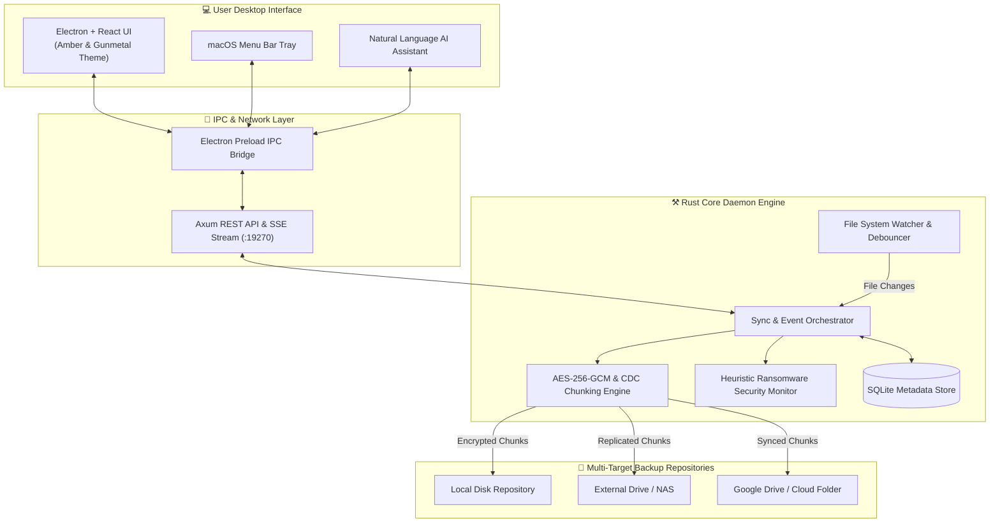

<div align="center">

# ⚒️ FERRUM

### **Iron-Forged, Zero-Trust Continuous Data Protection & Automated Recovery Engine**

[](https://github.com/Sagarverse/ferrum)
[](https://www.rust-lang.org/)
[](https://www.electronjs.org/)
[](https://react.dev/)
[](LICENSE)

*Iron rusts. Ferrum doesn't.* 🔥

---

[Key Features](#-key-features) • [Architecture](#%EF%B8%8F-architecture-overview) • [Quick Start](#-quick-start) • [Security & Encryption](#-security--encryption) • [API Reference](#-api-endpoints) • [Tech Stack](#-tech-stack)

</div>

---

## 🌟 Executive Summary

**Ferrum** (Latin for *iron*) is a high-performance, real-time continuous data protection (CDP) engine built in **Rust** with an **Electron + React** desktop interface. Designed with zero-trust security principles, Ferrum delivers sub-millisecond file change detection, content-defined chunking (CDC), AES-256-GCM encryption, automatic deduplication, multi-target storage replication (including cloud/Google Drive targets), and proactive ransomware anomaly detection.

---

## ✨ Key Features

- **⚒️ High-Performance Dual Engine**:
  - **Rust Daemon**: Multi-threaded `Axum` + `Tokio` backend managing event streams, cryptographic operations, SQLite metadata, and file watcher events.
  - **Electron + React UI**: Custom glassmorphism UI with real-time SSE telemetry, interactive charts, and system status indicators.
- **🛡️ Real-Time Continuous Data Protection (CDP)**:
  - Low-overhead filesystem watcher monitors target directories for creates, edits, moves, and deletes with debounced batch processing.
- **🔒 Zero-Trust Cryptographic Engine**:
  - **AES-256-GCM** encryption at rest for all backup chunks.
  - **Content-Defined Chunking (CDC)** with SHA-256 cryptographic digest verification.
  - Cross-file deduplication to minimize storage footprint across versions.
- **⚡ Flexible Repository Replication**:
  - Route backups to local drives, external storage, NAS, or cloud-synced folders (e.g. Google Drive, OneDrive).
  - Per-repository ON/OFF toggles and health check verification.
- **☣️ Heuristic Ransomware Protection**:
  - Real-time entropy analysis and rapid-change detection to identify suspicious file encryption patterns before corruption spreads.
- **💻 macOS Menu Bar & Silent Background Operation**:
  - Runs unobtrusively in the macOS status bar (`trayTemplate`), continuing background protection even when the window is closed.
- **🤖 Natural Language AI Assistant**:
  - Built-in assistant capable of executing backup rules, inspecting system health, and answering queries in plain language.

---

## 🏗️ Architecture Overview



---

## 🚀 Quick Start

### Prerequisites

- **Node.js** (v18 or higher) & `npm`
- **Rust Toolchain** (`cargo` 1.70+)

### 1. Clone the Repository

```bash
git clone https://github.com/Sagarverse/ferrum.git
cd ferrum
```

### 2. Build the Core Engine (Rust)

```bash
cd core
cargo build --release
```

### 3. Launch the Application (Electron + Vite)

```bash
cd ../ui
npm install
npm run app
```

---

## 🔒 Security & Encryption

Ferrum treats data protection as an absolute zero-trust operation:

1. **Chunking & Hashing**: Incoming files are split into variable-sized chunks. Each chunk is hashed using SHA-256 to generate a unique content identifier.
2. **Deduplication**: If a chunk hash already exists in storage, only the reference metadata is updated, preventing duplicate storage consumption.
3. **AES-256-GCM Encryption**: Each chunk is encrypted with AES-256-GCM using authenticated encryption before writing to disk.
4. **Verifiable Restore**: Restores check SHA-256 hashes against original manifests to guarantee 100% data integrity before writing restored files.

---

## 📡 API Endpoints

The Rust engine exposes an internal HTTP API (`http://127.0.0.1:19270`) used by the desktop app and available for CLI integrations:

| Method | Endpoint | Description |
|--------|----------|-------------|
| `GET` | `/api/health` | System health check and memory metrics |
| `GET` | `/api/protected` | List monitored protected paths |
| `POST` | `/api/protected` | Add a new folder or file to real-time protection |
| `GET` | `/api/events/stream` | Server-Sent Events (SSE) telemetry stream |
| `GET` | `/api/versions` | List available point-in-time snapshot versions |
| `POST` | `/api/restore` | Trigger point-in-time file recovery |
| `GET` | `/api/replicas` | Retrieve backup repository health and configuration |

---

## 🧰 Tech Stack

| Component | Technology | Purpose |
|-----------|------------|---------|
| **Core Engine** | Rust 2021 Edition | High performance, memory safety, concurrency |
| **Web Server** | Axum & Tokio | Async REST API & SSE streaming |
| **Database** | SQLite & Rusqlite | Transactional metadata & manifest storage |
| **Cryptography** | `aes-gcm`, `sha2`, `blake3` | Encrypted at-rest chunk storage & verification |
| **Desktop Shell**| Electron v36 | Cross-platform desktop lifecycle & tray integration |
| **Frontend UI** | React 18 & TypeScript | Reactive state management & component hierarchy |
| **Build System**| Vite & Cargo | Fast hot-reloading development & optimized release binaries |

---

## 📄 License

Distributed under the **MIT License**. See [`LICENSE`](LICENSE) for complete terms.

---

<div align="center">

**Iron rusts. Ferrum doesn't.**

Designed & Developed with ⚒️ by **[Sagarverse](https://github.com/Sagarverse)**

</div>
