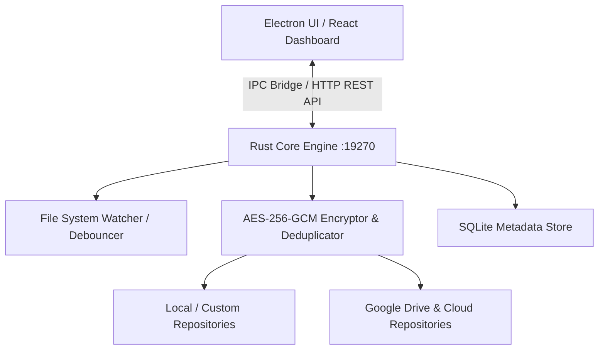

# 🛡️ Metallic Mini

> **Ultra-Fast, Zero-Trust Continuous Data Protection & Automated Recovery Engine**


**Metallic Mini** is an enterprise-grade, lightweight data protection platform designed to provide real-time file system monitoring, AES-256-GCM chunked encryption, deduplication, multiple backup storage target routing (including Google Drive folder integration), anti-ransomware protection, and instantaneous version recovery.

---

## ✨ Key Features

- **🚀 Dual-Engine Architecture**: Built with a high-performance **Rust Core Daemon** (`Axum` + `Tokio`) and a sleek, modern **Electron + React UI**.
- **🛡️ Real-Time File System Watcher**: Continuously monitors protected directories for file changes, creations, and deletions with debounced batch processing.
- **⚡ Dynamic Repository Routing & Customization**:
  - Assign specific backup repositories to individual folders.
  - Full toggle controls to turn repositories ON/OFF.
  - External repository support (e.g. Google Drive synced folders, external drives, NAS).
- **🔒 Zero-Trust Encryption & Deduplication**:
  - Content-defined chunking with SHA-256 manifest verification.
  - AES-256-GCM data encryption at rest.
  - Automatic cross-file chunk deduplication to optimize storage usage.
- **🗑️ Smart Deletion & Sync**: Synchronized data removal—deleting a protected file allows corresponding backup cleanups while maintaining version history integrity.
- **💻 macOS Menu Bar & Background Execution**: Minimizes directly into the macOS status bar for uninterrupted background file protection.
- **🤖 Built-in AI Assistant**: Interactive assistant capable of executing administrative actions, setting backup policies, and inspecting protection status.

---

## 🏗️ Architecture Overview



---

## 🛠️ Quick Start & Installation

### Prerequisites

- **Node.js** (v18+) & `npm`
- **Rust** (Cargo 1.70+)

### 1. Clone the Repository

```bash
git clone https://github.com/Sagarverse/metallic-mini.git
cd metallic-mini
```

### 2. Build the Rust Backend Core

```bash
cd core
cargo build --release
```

### 3. Install & Run the UI Application

```bash
cd ../ui
npm install
npm run app
```

---

## 📖 Usage Guide

1. **Add Folders to Protect**:
   Navigate to **Protected Data** and click **+ Add Folder**. Choose your desired target repository or use default multi-repo routing.
2. **Configure Storage Repositories**:
   Go to **Storage**, where you can manage local folders, mounted NAS drives, or paste your **Google Drive folder path** as a backup target.
3. **Background Monitoring**:
   Closing the app main window minimizes Metallic Mini straight into your **macOS Menu Bar**, where background monitoring continues without interruption.
4. **Restore & Recover**:
   Access **Versions & Recovery** to perform point-in-time file restores or target specific historical snapshots.

---

## 🛡️ License

Distributed under the MIT License. See `LICENSE` for more information.

---

<p align="center">Made with ❤️ by <a href="https://github.com/Sagarverse">Sagarverse</a></p>
