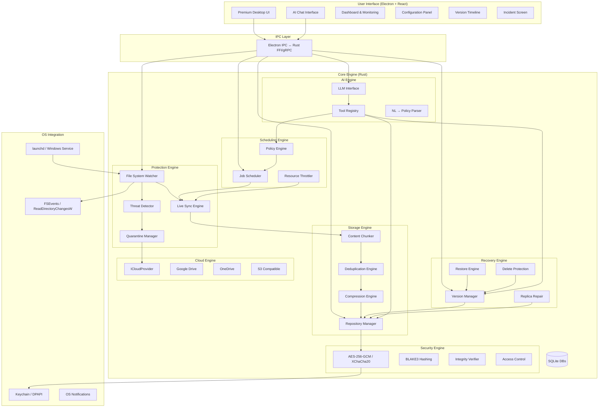

# Ferrum — Implementation Plan

## "Protect Once. Recover Anytime."

A professional-grade, open-source data protection platform with continuous backup, versioning, ransomware defense, AI-assisted configuration, and automated recovery.

---

## Platform Decision

> [!IMPORTANT]
> **You are on macOS**, but [Agent.md](file:///Users/sagarm/Mine/Metallic/Agent.md) specifies a **Windows-native** application with C#/.NET 8/WinUI 3 frontend and Rust core engine. WinUI 3 and Windows Services **cannot be built or tested on macOS**.
>
> I propose building the application using a **cross-platform architecture** that delivers the same enterprise-grade experience but can be developed and tested on your Mac right now:
>
> | Component | Agent.md Spec | Proposed (Cross-Platform) |
> |-----------|--------------|--------------------------|
> | **Frontend** | C# / WinUI 3 | **Electron + React + TypeScript** (premium desktop UI, runs on macOS/Windows/Linux) |
> | **Core Engine** | Rust | **Rust** (unchanged — cross-platform by design) |
> | **Service Layer** | Windows Service | **Rust daemon** with OS-specific adapters (launchd on macOS, Windows Service on Windows) |
> | **Database** | SQLite | **SQLite** (unchanged) |
> | **AI Engine** | Ollama / LLM | **Ollama + OpenAI-compatible API** (unchanged) |
> | **Installer** | Windows MSI | **Platform-specific installers** (DMG/MSI/AppImage) |
>
> This preserves **100% of the architectural intent** from Agent.md while letting you build, test, and run on your Mac today. The Electron frontend will look and feel premium — dark glassmorphism, Commvault-inspired information architecture, AI chat interface.

> [!WARNING]
> **Windows-specific features** (minifilter driver, DPAPI, Windows ACLs) will be implemented behind platform abstraction layers. On macOS, equivalent protections (FSEvents, Keychain, POSIX ACLs) will be used. The architecture ensures a future Windows-native frontend (WinUI 3) can be swapped in without touching the core engine.

---

## Open Questions

> [!IMPORTANT]
> 1. **AI Provider**: Should we default to **Ollama** (fully offline, requires ~8GB RAM for a decent model) or start with **OpenAI/Gemini API** (cloud, simpler setup) with Ollama as an option? I recommend starting with OpenAI-compatible API with Ollama support built-in.
>
> 2. **Cloud Storage**: For the emergency cloud escalation, which provider should we implement first? I recommend **Google Drive** as the primary, with the `ICloudProvider` abstraction ready for others.
>
> 3. **Encryption Password**: Should the initial version use a master password set during first-run, or integrate with OS keychain (macOS Keychain / Windows DPAPI) from day one? I recommend OS keychain integration from the start.
>
> 4. **Scope for Phase 1**: Given the 68 requirements in Agent.md, should I build everything in one go (will take significant time), or deliver in the 8 phases defined in sections 64? I recommend phased delivery, starting with Phases 1-4 as the MVP.

---

## Architecture Overview



---

## Project Structure

```
ferrum/
├── README.md
├── LICENSE (MIT)
├── CONTRIBUTING.md
├── SECURITY.md
├── ARCHITECTURE.md
├── ROADMAP.md
├── CHANGELOG.md
│
├── core/                          # Rust core engine
│   ├── Cargo.toml
│   ├── src/
│   │   ├── lib.rs                 # Library root
│   │   ├── main.rs                # Daemon entry point
│   │   │
│   │   ├── config/                # Configuration management
│   │   │   ├── mod.rs
│   │   │   ├── policy.rs          # Backup policies
│   │   │   └── settings.rs        # App settings
│   │   │
│   │   ├── watcher/               # File system monitoring
│   │   │   ├── mod.rs
│   │   │   ├── events.rs          # Event types & queue
│   │   │   ├── platform/
│   │   │   │   ├── mod.rs
│   │   │   │   ├── macos.rs       # FSEvents
│   │   │   │   └── windows.rs     # ReadDirectoryChangesW / USN Journal
│   │   │   └── debouncer.rs       # Event deduplication
│   │   │
│   │   ├── repository/            # Protected storage repositories
│   │   │   ├── mod.rs
│   │   │   ├── chunk.rs           # Content chunking (CDC)
│   │   │   ├── dedup.rs           # Deduplication
│   │   │   ├── compress.rs        # LZ4/Zstd compression
│   │   │   ├── store.rs           # Content-addressable store
│   │   │   ├── manifest.rs        # Version manifests
│   │   │   └── gc.rs              # Garbage collection
│   │   │
│   │   ├── crypto/                # Encryption & integrity
│   │   │   ├── mod.rs
│   │   │   ├── aes_gcm.rs         # AES-256-GCM
│   │   │   ├── xchacha.rs         # XChaCha20-Poly1305
│   │   │   ├── keys.rs            # Key derivation & management
│   │   │   └── integrity.rs       # BLAKE3 verification
│   │   │
│   │   ├── versioning/            # Version management
│   │   │   ├── mod.rs
│   │   │   ├── snapshot.rs        # Point-in-time snapshots
│   │   │   ├── timeline.rs        # Version timeline
│   │   │   └── retention.rs       # Retention policies
│   │   │
│   │   ├── sync/                  # Live synchronization
│   │   │   ├── mod.rs
│   │   │   ├── engine.rs          # Sync orchestrator
│   │   │   ├── replica.rs         # Replica management
│   │   │   └── conflict.rs        # Conflict resolution
│   │   │
│   │   ├── security/              # Threat detection
│   │   │   ├── mod.rs
│   │   │   ├── detector.rs        # Behavioral analysis
│   │   │   ├── rules.rs           # Rule-based detection
│   │   │   ├── scoring.rs         # Threat scoring (0-100)
│   │   │   ├── quarantine.rs      # Quarantine manager
│   │   │   ├── incident.rs        # Incident tracking
│   │   │   └── process_monitor.rs # Process monitoring
│   │   │
│   │   ├── recovery/              # Data recovery
│   │   │   ├── mod.rs
│   │   │   ├── restore.rs         # Restore engine
│   │   │   ├── repair.rs          # Replica repair
│   │   │   └── delete_protect.rs  # Delete protection
│   │   │
│   │   ├── scheduler/             # Job scheduling
│   │   │   ├── mod.rs
│   │   │   ├── jobs.rs            # Job definitions
│   │   │   ├── cron.rs            # Cron-like scheduling
│   │   │   └── throttle.rs        # Resource throttling
│   │   │
│   │   ├── cloud/                 # Cloud escalation
│   │   │   ├── mod.rs
│   │   │   ├── provider.rs        # ICloudProvider trait
│   │   │   ├── gdrive.rs          # Google Drive adapter
│   │   │   └── upload.rs          # Chunked resumable upload
│   │   │
│   │   ├── ai/                    # AI engine
│   │   │   ├── mod.rs
│   │   │   ├── llm.rs             # LLM client (Ollama/OpenAI)
│   │   │   ├── tools.rs           # Tool definitions
│   │   │   ├── parser.rs          # NL → policy parser
│   │   │   └── safety.rs          # Action confirmation logic
│   │   │
│   │   ├── db/                    # Database layer
│   │   │   ├── mod.rs
│   │   │   ├── schema.rs          # SQLite schemas
│   │   │   ├── migrations.rs      # Schema migrations
│   │   │   ├── metadata.rs        # File metadata DB
│   │   │   ├── jobs.rs            # Job history DB
│   │   │   └── security.rs        # Security events DB
│   │   │
│   │   ├── api/                   # IPC API layer
│   │   │   ├── mod.rs
│   │   │   ├── server.rs          # Local HTTP/WebSocket server
│   │   │   ├── handlers.rs        # Request handlers
│   │   │   └── models.rs          # API models
│   │   │
│   │   ├── health/                # Health monitoring
│   │   │   ├── mod.rs
│   │   │   └── score.rs           # Protection score (0-100)
│   │   │
│   │   └── platform/              # OS abstractions
│   │       ├── mod.rs
│   │       ├── macos.rs
│   │       └── windows.rs
│   │
│   └── tests/                     # Rust tests
│       ├── unit/
│       ├── integration/
│       └── stress/
│
├── ui/                            # Electron + React frontend
│   ├── package.json
│   ├── electron/
│   │   ├── main.ts                # Electron main process
│   │   ├── preload.ts             # Context bridge
│   │   └── ipc.ts                 # IPC handlers
│   │
│   ├── src/
│   │   ├── App.tsx
│   │   ├── index.tsx
│   │   ├── index.css              # Global design system
│   │   │
│   │   ├── components/
│   │   │   ├── layout/
│   │   │   │   ├── Sidebar.tsx
│   │   │   │   ├── TopBar.tsx
│   │   │   │   └── MainLayout.tsx
│   │   │   │
│   │   │   ├── dashboard/
│   │   │   │   ├── ProtectionScore.tsx
│   │   │   │   ├── SystemStatus.tsx
│   │   │   │   ├── StorageChart.tsx
│   │   │   │   └── RecentActivity.tsx
│   │   │   │
│   │   │   ├── ai/
│   │   │   │   ├── ChatInterface.tsx
│   │   │   │   ├── ChatMessage.tsx
│   │   │   │   ├── SuggestedActions.tsx
│   │   │   │   └── ActionPreview.tsx
│   │   │   │
│   │   │   ├── protection/
│   │   │   │   ├── ProtectedItems.tsx
│   │   │   │   ├── FolderPicker.tsx
│   │   │   │   └── ProtectionWizard.tsx
│   │   │   │
│   │   │   ├── versions/
│   │   │   │   ├── VersionTimeline.tsx
│   │   │   │   ├── VersionCard.tsx
│   │   │   │   └── VersionBrowser.tsx
│   │   │   │
│   │   │   ├── recovery/
│   │   │   │   ├── RestorePanel.tsx
│   │   │   │   ├── RestoreProgress.tsx
│   │   │   │   └── RestoreOptions.tsx
│   │   │   │
│   │   │   ├── security/
│   │   │   │   ├── ThreatDashboard.tsx
│   │   │   │   ├── IncidentScreen.tsx
│   │   │   │   ├── LockdownOverlay.tsx
│   │   │   │   └── SecurityScore.tsx
│   │   │   │
│   │   │   ├── storage/
│   │   │   │   ├── StorageManager.tsx
│   │   │   │   ├── ReplicaStatus.tsx
│   │   │   │   └── DriveInfo.tsx
│   │   │   │
│   │   │   ├── config/
│   │   │   │   ├── ConfigPanel.tsx
│   │   │   │   ├── PolicyEditor.tsx
│   │   │   │   ├── ScheduleEditor.tsx
│   │   │   │   └── ResourceLimits.tsx
│   │   │   │
│   │   │   └── common/
│   │   │       ├── Button.tsx
│   │   │       ├── Card.tsx
│   │   │       ├── Modal.tsx
│   │   │       ├── Badge.tsx
│   │   │       ├── Chart.tsx
│   │   │       └── Notification.tsx
│   │   │
│   │   ├── pages/
│   │   │   ├── Home.tsx            # AI chat + dashboard
│   │   │   ├── ProtectedData.tsx
│   │   │   ├── Backup.tsx
│   │   │   ├── Versions.tsx
│   │   │   ├── Recovery.tsx
│   │   │   ├── Storage.tsx
│   │   │   ├── Security.tsx
│   │   │   ├── Incidents.tsx
│   │   │   ├── Schedules.tsx
│   │   │   ├── Cloud.tsx
│   │   │   ├── Reports.tsx
│   │   │   └── Settings.tsx
│   │   │
│   │   ├── hooks/                  # React hooks
│   │   │   ├── useProtection.ts
│   │   │   ├── useVersions.ts
│   │   │   ├── useHealth.ts
│   │   │   ├── useSecurity.ts
│   │   │   └── useAI.ts
│   │   │
│   │   ├── store/                  # State management
│   │   │   ├── index.ts
│   │   │   ├── protectionSlice.ts
│   │   │   ├── securitySlice.ts
│   │   │   └── settingsSlice.ts
│   │   │
│   │   └── utils/
│   │       ├── api.ts              # Core engine API client
│   │       ├── formatters.ts
│   │       └── constants.ts
│   │
│   └── public/
│       └── assets/
│
├── docs/
│   ├── installation.md
│   ├── architecture.md
│   ├── development.md
│   ├── repository-format.md
│   ├── encryption.md
│   ├── ai-engine.md
│   ├── ransomware-detection.md
│   ├── recovery.md
│   ├── cloud-escalation.md
│   ├── troubleshooting.md
│   ├── security-model.md
│   └── limitations.md
│
├── scripts/
│   ├── setup.sh
│   ├── build.sh
│   └── test.sh
│
├── .github/
│   ├── ISSUE_TEMPLATE/
│   │   ├── bug_report.md
│   │   └── feature_request.md
│   ├── PULL_REQUEST_TEMPLATE.md
│   └── workflows/
│       ├── ci.yml
│       └── release.yml
│
└── installer/
    ├── macos/
    └── windows/
```

---

## Proposed Changes

### Phase 1: Foundation (Core Engine + Basic UI)

This is what we build first. It delivers a working application with:
- File/folder selection and monitoring
- Content-addressable storage with BLAKE3 hashing
- Content-defined chunking (CDC) for efficient storage
- Basic versioning (initial + incremental snapshots)
- Single replica support
- SQLite metadata database
- Premium Electron UI with dashboard and AI chat skeleton
- Local HTTP API for UI ↔ Core communication

---

### Rust Core Engine

#### [NEW] `core/Cargo.toml`
Rust workspace manifest with dependencies: `blake3`, `lz4_flex`, `aes-gcm`, `chacha20poly1305`, `rusqlite`, `notify` (cross-platform fs watcher), `tokio`, `axum` (HTTP API), `serde`, `uuid`, `chrono`, etc.

#### [NEW] `core/src/lib.rs`
Library root re-exporting all modules.

#### [NEW] `core/src/main.rs`
Daemon entry point — starts the Axum HTTP server, initializes SQLite DBs, starts the file watcher, and manages the protection lifecycle.

#### [NEW] `core/src/config/` (mod.rs, policy.rs, settings.rs)
Configuration types: `BackupPolicy`, `ProtectionLevel`, `RetentionPolicy`, `ResourceLimits`, `AppSettings`. Serializable to/from JSON. Stored in SQLite.

#### [NEW] `core/src/watcher/` (mod.rs, events.rs, platform/, debouncer.rs)
Cross-platform file system watcher using the `notify` crate. Events are debounced, deduplicated, and queued into an async channel. Platform-specific backends: FSEvents (macOS), ReadDirectoryChangesW (Windows).

#### [NEW] `core/src/repository/` (mod.rs, chunk.rs, dedup.rs, compress.rs, store.rs, manifest.rs, gc.rs)
Content-addressable storage engine:
- **Chunker**: Content-defined chunking (FastCDC) with configurable min/avg/max chunk sizes
- **Dedup**: Hash-based deduplication using BLAKE3
- **Compress**: LZ4 fast compression (default) + Zstd for archival
- **Store**: Flat-file chunk store organized by hash prefix (`aa/bb/aabbccdd...`)
- **Manifest**: JSON manifests mapping file paths → ordered list of chunk hashes
- **GC**: Mark-and-sweep garbage collection for unreferenced chunks

#### [NEW] `core/src/crypto/` (mod.rs, aes_gcm.rs, xchacha.rs, keys.rs, integrity.rs)
AES-256-GCM encryption with BLAKE3 integrity. Key derivation via Argon2id. Keys stored in OS keychain (macOS Keychain / Windows DPAPI) via `keyring` crate.

#### [NEW] `core/src/versioning/` (mod.rs, snapshot.rs, timeline.rs, retention.rs)
Snapshot-based versioning. Each version is a manifest of chunk references. Copy-on-write semantics — never overwrites a committed version. Retention policies (keep N versions, keep for N days, GFS rotation).

#### [NEW] `core/src/sync/` (mod.rs, engine.rs, replica.rs, conflict.rs)
Sync engine that processes watcher events, chunks new/modified files, deduplicates, and writes to replica repositories. Supports multiple replicas. Conflict resolution for simultaneous changes.

#### [NEW] `core/src/security/` (mod.rs, detector.rs, rules.rs, scoring.rs, quarantine.rs, incident.rs, process_monitor.rs)
Threat detection system:
- **Rules**: Mass deletion, rapid extension changes, high-entropy rewrites, known ransomware patterns
- **Scoring**: Behavioral threat score 0-100 (Normal/Watch/Suspicious/Critical)
- **Quarantine**: Freezes sync propagation, preserves healthy versions, creates incident
- **Process Monitor**: Tracks which processes access protected files

#### [NEW] `core/src/recovery/` (mod.rs, restore.rs, repair.rs, delete_protect.rs)
Restore engine that reassembles files from chunk store. Delete protection that detects source deletion and preserves repository versions. Replica repair from healthy sources.

#### [NEW] `core/src/scheduler/` (mod.rs, jobs.rs, cron.rs, throttle.rs)
Job scheduler with cron-like scheduling, idle-time detection, resource throttling (CPU/memory/IO limits), and adaptive backpressure.

#### [NEW] `core/src/cloud/` (mod.rs, provider.rs, gdrive.rs, upload.rs)
`ICloudProvider` trait with Google Drive implementation. Chunked, resumable, encrypted uploads. Bandwidth limiting.

#### [NEW] `core/src/ai/` (mod.rs, llm.rs, tools.rs, parser.rs, safety.rs)
AI engine with tool-calling interface. Connects to Ollama or OpenAI-compatible APIs. Structured tools (get_status, create_policy, restore_version, etc.). Safety layer requiring confirmation for destructive operations.

#### [NEW] `core/src/db/` (mod.rs, schema.rs, migrations.rs, metadata.rs, jobs.rs, security.rs)
SQLite database layer with WAL mode. Separate logical databases: metadata (file index), jobs (backup history), security (incidents, audit log). Schema migrations.

#### [NEW] `core/src/api/` (mod.rs, server.rs, handlers.rs, models.rs)
Local Axum HTTP + WebSocket server. REST API for UI operations. WebSocket for real-time status updates, AI chat streaming, and live notifications.

#### [NEW] `core/src/health/` (mod.rs, score.rs)
Aggregated health score from all subsystems. Protection Score 0-100.

#### [NEW] `core/src/platform/` (mod.rs, macos.rs, windows.rs)
OS abstraction layer for keychain, notifications, daemon management, ACLs.

---

### Electron + React Frontend

#### [NEW] `ui/package.json`
Electron 30+ / React 18+ / TypeScript / Vite / Zustand (state) / Recharts (charts) / Framer Motion (animations) / Lucide React (icons)

#### [NEW] `ui/src/index.css`
Complete design system: CSS custom properties for dark/light themes, glassmorphism tokens, typography scale (Inter font), spacing, border-radius, shadows, color palette (deep navy → electric blue gradients for enterprise trust), animation keyframes.

#### [NEW] `ui/src/pages/Home.tsx`
The flagship screen: AI chat interface (center) + live system status panel (right). Chat bubbles with suggested actions ("Protect a folder", "Check backup health"). Real-time status cards: Protection Score, Replica Health, Threat Status, Storage Usage.

#### [NEW] All other pages and components
As listed in the project structure above. Each page maps to a sidebar navigation item matching the Agent.md specification (Protected Data, Backup, Versions, Recovery, Storage, Security, Incidents, Schedules, Cloud, Reports, Settings).

---

### Documentation & Open Source

#### [NEW] `README.md`
Professional GitHub README with badges, screenshots, feature list, quick start, architecture overview.

#### [NEW] `ARCHITECTURE.md`, `CONTRIBUTING.md`, `SECURITY.md`, `ROADMAP.md`, `CHANGELOG.md`, `LICENSE`
Standard open-source project files.

---

## Technology Stack Summary

| Layer | Technology | Rationale |
|-------|-----------|-----------|
| **Core Engine** | Rust | Memory safety, performance, cross-platform, excellent for file I/O |
| **Hashing** | BLAKE3 | Fastest cryptographic hash, SIMD-accelerated |
| **Chunking** | FastCDC | Content-defined chunking for efficient deduplication |
| **Compression** | LZ4 (fast) / Zstd (archival) | Best speed/ratio tradeoffs |
| **Encryption** | AES-256-GCM + XChaCha20-Poly1305 | Hardware-accelerated authenticated encryption |
| **Key Derivation** | Argon2id | Memory-hard KDF, resistant to GPU attacks |
| **Database** | SQLite (WAL mode) | Proven, embedded, zero-config |
| **API** | Axum (HTTP + WebSocket) | High-performance async Rust web framework |
| **Frontend** | Electron + React + TypeScript | Cross-platform premium desktop UI |
| **State Management** | Zustand | Lightweight, TypeScript-first |
| **Charts** | Recharts | React-native charting |
| **Animations** | Framer Motion | Production-grade animations |
| **Icons** | Lucide React | Beautiful, consistent icon set |
| **AI** | Ollama / OpenAI API | Provider-independent LLM integration |

---

## Verification Plan

### Automated Tests
```bash
# Rust unit tests
cd core && cargo test

# Rust integration tests  
cd core && cargo test --test integration

# Frontend tests
cd ui && npm test
```

### Manual Verification
1. Launch the Electron app and Rust daemon
2. Select a folder for protection via the AI chat ("Protect my Documents folder")
3. Verify files are chunked, deduplicated, and stored in the repository
4. Modify files and verify incremental versions are created
5. Delete a protected file and verify delete protection works
6. Restore from a previous version
7. Verify the dashboard shows accurate Protection Score, storage usage, and health
8. Test the version timeline browser
9. Simulate suspicious activity (rapid mass file changes) and verify quarantine triggers

### Acceptance Test (from Agent.md Section 65)
All 26 acceptance test scenarios will be verified after the complete implementation.

---

## Build Order

| Step | What | Deliverable |
|------|------|-------------|
| 1 | Rust project scaffold + SQLite schema | Compiling Rust crate |
| 2 | Content-addressable store + BLAKE3 + FastCDC chunker | Working chunk store with tests |
| 3 | Version manager + snapshot system | Create/list/restore versions |
| 4 | File system watcher + sync engine | Live monitoring + auto-backup |
| 5 | Security / threat detection | Behavioral scoring + quarantine |
| 6 | Encryption layer | AES-256-GCM encrypted repos |
| 7 | Axum HTTP + WebSocket API | Full REST + realtime API |
| 8 | Electron + React UI scaffold | Running desktop app |
| 9 | Dashboard + AI chat interface | Premium home screen |
| 10 | All remaining pages | Complete UI |
| 11 | AI engine (Ollama/OpenAI) | NL configuration working |
| 12 | Cloud escalation | Google Drive encrypted upload |
| 13 | Scheduler + resource throttling | Background job management |
| 14 | Delete protection + replica repair | Full recovery system |
| 15 | Integration tests + acceptance tests | Verified working system |
| 16 | Documentation + open-source files | GitHub-ready repository |

---

> [!CAUTION]
> This is an extremely large project (~50+ source files, ~15,000+ lines of code). Building it completely and correctly will require significant time. Please confirm the plan so I can begin implementation immediately, starting from the Rust core engine foundation.
